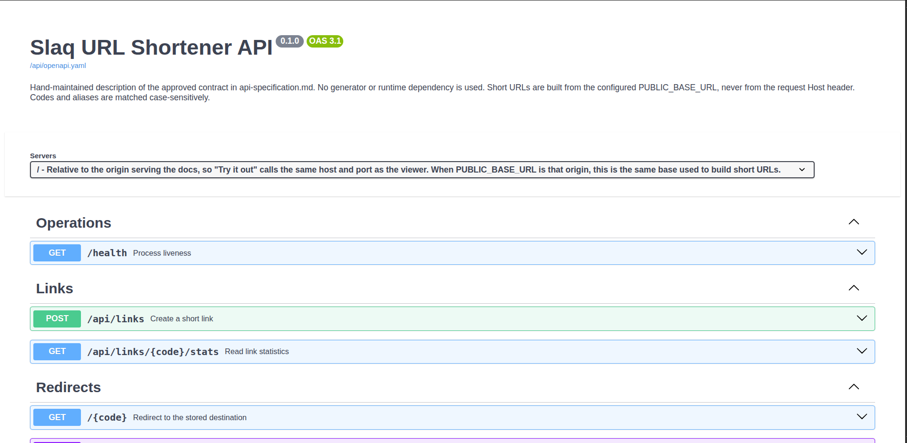

# Slaq

> A small, backend-focused URL shortener REST API built with Node.js, TypeScript, Express, and SQLite.

[](https://nodejs.org/)
[](https://www.typescriptlang.org/)
[](https://expressjs.com/)
[](https://github.com/WiseLibs/better-sqlite3)

## Table of Contents

- [Overview](#overview)
- [Key Features](#key-features)
- [Tech Stack](#tech-stack)
- [Project Structure](#project-structure)
- [Getting Started](#getting-started)
- [Usage](#usage)
- [Contributing & License](#contributing--license)

## Overview

Long URLs are awkward to share, and most people also want to know whether anyone clicked them. Slaq turns a long `http`/`https` URL into a short link, redirects visitors to the original destination, and keeps a simple click count for every link.

It is a single-process service with a small JSON API. Links can use a generated code or a custom alias, and they can optionally expire. Data is stored in a local SQLite file. There is no frontend.

## Key Features

- **Short links with generated codes:** 7-character Base62 codes, with five generation attempts if a collision occurs.
- **Custom aliases:** 3–32 characters from `A–Z a–z 0–9 _ -`, case-sensitive. `api` and `health` are reserved (case-insensitive).
- **Redirects:** `GET /:code` answers with `302 Found` and a `Location` header.
- **Click tracking:** every successful `GET` redirect increments the click count. `HEAD` returns the same redirect without counting.
- **Link expiration:** optional `expiresAt`. Expired links return `410 Gone`, and no click is recorded.
- **Statistics:** per-link click count, creation and expiry times, last click time, and an `isExpired` flag. Expired links still return statistics.
- **Request validation:** Zod validation. Only `http:`/`https:` destinations are accepted, up to 2048 characters, with no embedded credentials or control characters.
- **Consistent errors:** every error uses one JSON envelope with a stable error code.
- **Fail-fast configuration:** an invalid `PORT` or `PUBLIC_BASE_URL` stops the server before it listens or opens the database.
- **Automated tests:** Vitest with an in-memory SQLite database and an injected clock.
- **API documentation:** a written specification, an OpenAPI 3.1 description, and a locally served interactive Swagger UI.

## Tech Stack

| Area | Technology |
|---|---|
| Runtime | Node.js 24 LTS (native ESM) |
| Language | TypeScript 6 (`strict`, `noUncheckedIndexedAccess`) |
| Web framework | Express 5 |
| Database | SQLite via `better-sqlite3` 13 |
| Validation | Zod 4 |
| Testing | Vitest 5, Supertest |
| Linting | ESLint 10 (flat config, `typescript-eslint`) |
| Dev runner | `tsx` |
| API viewer | Swagger UI 5 (`swagger-ui-dist`, served locally) |

Versions are the ranges declared in `package.json`; the committed `package-lock.json` pins exact versions.

## Project Structure

```
slaq-url-shortener/
├── src/
│   ├── server.ts              # Entry point: load config, open SQLite, start listening
│   ├── app.ts                 # createApp({ db, clock, config }): middleware and routes
│   ├── config.ts              # PORT / PUBLIC_BASE_URL / NODE_ENV resolution and validation
│   ├── db/
│   │   ├── connection.ts      # Opens SQLite and applies pragmas
│   │   ├── schema.ts          # Idempotent `links` table creation
│   │   ├── pragma.ts          # Typed pragma helper
│   │   └── id.ts              # Typed insert-id helper
│   ├── lib/
│   │   ├── clock.ts           # Injectable clock
│   │   ├── code-generator.ts  # Base62 short-code generator
│   │   ├── errors.ts          # Typed application errors and error codes
│   │   └── expiry.ts          # Expiry comparison logic
│   ├── middleware/
│   │   ├── error-handler.ts   # Single place that writes error responses
│   │   └── not-found.ts       # 404 handler for unmatched routes
│   ├── modules/docs/
│   │   └── docs.routes.ts       # Swagger UI page, local assets, OpenAPI spec
│   └── modules/links/
│       ├── links.routes.ts      # Route definitions
│       ├── links.controller.ts  # HTTP boundary: validate, call service, shape response
│       ├── links.service.ts     # Business rules: aliases, expiry, collisions
│       ├── links.repository.ts  # SQL access (prepared statements only)
│       ├── links.schemas.ts     # Zod request schemas
│       └── links.types.ts       # Shared types
├── tests/                     # Vitest unit and API integration tests
├── docs/
│   ├── api-specification.md   # REST API contract
│   ├── openapi.yaml           # OpenAPI 3.1 description
│   ├── requirements.md        # Functional and non-functional requirements
│   ├── database-design.md     # Schema, pragmas, queries
│   ├── security-guidelines.md
│   ├── coding-standards.md
│   ├── testing-strategy.md
│   ├── architecture-proposal.md
│   ├── images/                # Screenshots used in this README
│   │   └── swagger-screenshot.png
│   ├── decisions/             # Decision register and one ADR per decision (ADR-001…)
│   └── ai-workflow/           # Project state, tasks, agent role cards, prompts, workflows
├── AGENTS.md                  # Instructions for AI coding assistants
├── CHANGELOG.md
├── .env.example               # Example configuration
├── .nvmrc                     # Node version (24)
├── package.json
├── tsconfig.json              # Type-check configuration (no emit)
├── tsconfig.build.json        # Build configuration (emits to dist/)
├── eslint.config.js
└── vitest.config.ts
```

Requests flow through four layers: routes → controller → service → repository → SQLite. Only the repository contains SQL.

## Getting Started

### Prerequisites

- **Node.js 24 LTS** (`engines.node` is `^24.0.0`; `.nvmrc` contains `24`)
- **npm** (a lockfile is committed, so use `npm ci`)
- A writable working directory: the SQLite file is created there

### Installation

```bash
git clone https://github.com/gasparyanvazgen/slaq-url-shortener.git
cd slaq-url-shortener
nvm use          # optional, if you use nvm
npm ci
```

### Configuration

Configuration is read from the process environment once, at startup. **The server does not load `.env` files automatically** (there is no `dotenv` dependency), so export the variables in your shell or set them in your process manager. `.env.example` documents the same variables.

| Variable | Required | Default | Rules |
|---|---|---|---|
| `PORT` | No | `3000` | ASCII digits only, value 1–65535. Leading zeros are ignored (`03000` becomes `3000`); `0` and `0000` are rejected. |
| `PUBLIC_BASE_URL` | Required in production | `http://localhost:${PORT}` in development | Absolute `http:`/`https:` origin only: no path, query, fragment, or credentials. Short URLs are built from this value, never from the request `Host` header. |
| `NODE_ENV` | No | `development` | Any value other than `production` uses the development defaults. |

```bash
export PORT=3000
export PUBLIC_BASE_URL='http://localhost:3000'   # use your real public origin in production
export NODE_ENV=development
```

The database file is always `slaq.db` in the directory the server is started from (it is Git-ignored), and its schema is created automatically at startup. There is currently no setting to change its name or location, so start the server from the same directory each time.

## Usage

### Run the server

```bash
# Development, with automatic reload
npm run dev

# Production-style: compile, then run the compiled server
npm run build
npm start
```

### Run the checks

```bash
npm run typecheck   # tsc -p tsconfig.json
npm run lint        # eslint .
npm test            # vitest run
npm run build       # tsc -p tsconfig.build.json
```

Tests use an in-memory SQLite database and an injected clock, so no external service is needed.

### API

The examples assume `PUBLIC_BASE_URL=http://localhost:3000`.

| Method | Path | Purpose | Success |
|---|---|---|---|
| `POST` | `/api/links` | Create a short link | `201` |
| `GET` | `/api/links/:code/stats` | Get statistics | `200` |
| `GET` | `/api/docs` | Interactive Swagger UI | `200` |
| `GET` | `/api/docs/assets/*` | Swagger UI static assets | `200` |
| `GET` | `/api/openapi.yaml` | OpenAPI 3.1 description | `200` |
| `GET` / `HEAD` | `/:code` | Redirect to the original URL | `302` |
| `GET` | `/health` | Liveness check (does not touch the database) | `200` |

**Create a link** (`alias` and `expiresAt` are optional; `expiresAt` must be a real, future ISO 8601 instant with an offset):

```bash
curl -i -X POST http://localhost:3000/api/links \
  -H 'Content-Type: application/json' \
  -d '{"url":"https://example.com/path","alias":"my-link","expiresAt":"2026-12-31T00:00:00Z"}'
# 201, Location: http://localhost:3000/my-link
# {"code":"my-link","shortUrl":"http://localhost:3000/my-link",
#  "originalUrl":"https://example.com/path","createdAt":"...",
#  "expiresAt":"2026-12-31T00:00:00.000Z","isCustom":true}
```

Omit `alias` to get a generated 7-character code:

```bash
curl -i -X POST http://localhost:3000/api/links \
  -H 'Content-Type: application/json' \
  -d '{"url":"https://example.com/very/long/path"}'
```

**Follow a short link:**

```bash
curl -i http://localhost:3000/my-link
# 302, Location: https://example.com/path   (counts one click)
curl -I http://localhost:3000/my-link
# 302, same Location                         (HEAD: no click counted)
```

**Get statistics** (always sent with `Cache-Control: no-store`):

```bash
curl -i http://localhost:3000/api/links/my-link/stats
# 200
# {"code":"my-link","shortUrl":"...","originalUrl":"https://example.com/path",
#  "createdAt":"...","expiresAt":"...","isExpired":false,"isCustom":true,
#  "clickCount":1,"lastClickedAt":"..."}
```

**Health check:**

```bash
curl -i http://localhost:3000/health
# 200 {"status":"ok"}
```

### Errors

Every error uses the same envelope. Validation errors also include `details`.

```json
{ "error": { "code": "VALIDATION_ERROR", "message": "Request validation failed",
  "details": [ { "path": "url", "message": "url must be a valid http or https URL" } ] } }
```

| HTTP | `code` | When |
|---|---|---|
| 400 | `VALIDATION_ERROR` | Malformed body, invalid or over-long URL, invalid alias, invalid or non-future `expiresAt` |
| 400 | `RESERVED_ALIAS` | Alias is `api` or `health` |
| 404 | `NOT_FOUND` | Unknown code or unmatched route |
| 409 | `ALIAS_TAKEN` | Alias already exists |
| 410 | `LINK_EXPIRED` | The link has expired |
| 500 | `INTERNAL_ERROR` | Unexpected failure (generic message, no internals exposed) |

There is no endpoint to delete or edit links.

The full contract is in [`docs/api-specification.md`](docs/api-specification.md), and a machine-readable description is in [`docs/openapi.yaml`](docs/openapi.yaml).

### Interactive API documentation

Open [http://localhost:3000/api/docs](http://localhost:3000/api/docs) while the server is running. The page serves Swagger UI locally from `swagger-ui-dist` and loads `/api/openapi.yaml`; no CDN is used. Its `servers` entry is relative to the origin serving the page, so "Try it out" uses the same host and port (and matches `PUBLIC_BASE_URL` when that is the public origin). Note that browsers follow the `302` from `GET /{code}`, so trying that endpoint shows the destination page instead of the raw redirect.



### Known limitations

- No authentication, rate limiting, or abuse detection: anyone who can reach the service can create links and read statistics.
- Statistics are public: knowing a code reveals the destination URL, click count, and last click time.
- A single local SQLite file and a single process, with no migration mechanism. Concurrent write contention returns a generic `500` (no retry).
- Expired rows are kept and never cleaned up. Only aggregate click counts are stored (no per-click history).
- `GET /health` only shows that the process is running, not that the database is reachable.
- Behind a proxy or custom domain, set `PUBLIC_BASE_URL` explicitly, or generated short URLs will point to the wrong origin.

## Contributing & License

### Contributing

Contributions are welcome. Please keep changes small and focused, and make sure the checks pass before opening a pull request.

1. **Fork** the repository and clone your fork.
2. **Create a branch** from `dev`: `git checkout -b feat/short-description`.
3. **Install dependencies:** `npm ci`.
4. **Make your change**, adding or updating tests for any behavior change.
5. **Run all checks and make sure they pass:**
   ```bash
   npm run typecheck && npm run lint && npm test && npm run build
   ```
6. **Update documentation** if behavior or the API changes (`README.md`, `docs/api-specification.md`, `docs/openapi.yaml`, `CHANGELOG.md`).
7. **Commit** using the message convention below.
8. **Push** your branch and open a **pull request** against `dev`, describing what changed and why.

Do not add dependencies or change approved design decisions (see `docs/decisions/`) without discussing it in an issue first. Never commit `.env` files or secrets.

#### Commit message convention

All commit messages must strictly follow the `type:message` format, with **no space after the colon**.

```
type:message
```

Examples:

```
feat:add feature
fix:resolve bug
docs:update readme
```

Common types:

| Type | Use for |
|---|---|
| `feat` | A new feature |
| `fix` | A bug fix |
| `docs` | Documentation-only changes |
| `style` | Formatting changes with no code behavior change |
| `refactor` | Code changes that neither fix a bug nor add a feature |
| `perf` | Performance improvements |
| `test` | Adding or updating tests |
| `build` | Build system or dependency changes |
| `ci` | CI configuration changes |
| `chore` | Maintenance tasks and tooling |
| `revert` | Reverting a previous commit |

### License

This project is licensed under the [MIT License](LICENSE). Copyright (c) 2026 Vazgen Gasparyan.
